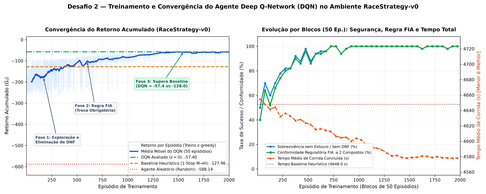
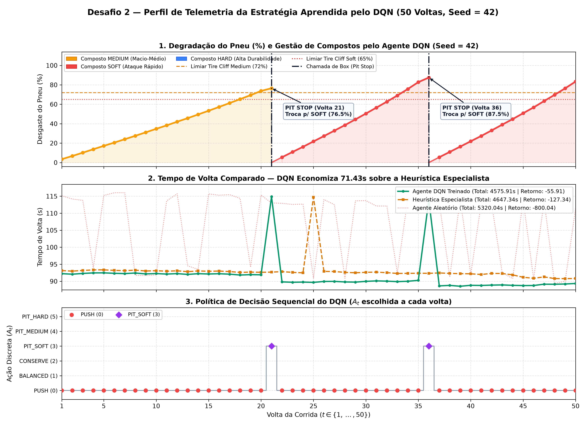

# PitWall RL — Otimização de Estratégia de Corrida via MDP (`RaceStrategy-v0`)

[-orange.svg)](#22-espaço-de-ações-e-dinâmica-física)

Especificação conceitual e formulação matemática do ambiente **`RaceStrategy-v0`**, que modela o problema de tomada de decisão estratégica de box (*Pit Wall Race Strategy*) em corridas de circuito fechado (Fórmula 1 / Endurance) como um **Processo de Decisão de Markov (MDP)**.

---

## 1. Visão Geral do Problema

Em corridas de alta performance com horizonte fixo de $N_{\mathrm{total}} = 50$ voltas, minimizar o tempo total de prova não equivale a exigir velocidade máxima em todas as voltas. O engenheiro de estratégia enfrenta um problema de decisão sequencial sob incerteza governado por quatro fatores acoplados:

1. **Ritmo de Pilotagem vs. Degradação Não-Linear (*Tire Cliff*):** Forçar o ritmo reduz o tempo da volta imediata, mas acelera o desgaste térmico e estrutural da borracha, precipitando o pneu para uma zona de perda severa de aderência.
2. **Dinâmica de Massa por Consumo de Combustível:** A queima contínua de combustível reduz o peso do carro ao longo da prova ($\approx 0.033\;\mathrm{s/kg}$), alterando progressivamente o tempo de volta e interagindo com o estado dos pneus.
3. **Custo Fixo de *Pit Stop* vs. Ganho de Composto Novo:** Uma parada nos boxes impõe uma perda fixa de tempo de travessia e troca ($T_{\mathrm{pit}} = 22.0\;\mathrm{s}$), exigindo que o ritmo superior dos pneus novos compense esse investimento nas voltas seguintes.
4. **Restrição Regulatória Desportiva (Regra FIA):** É obrigatório utilizar ao menos **dois compostos de pneus distintos** durante a corrida, sob pena de desclassificação (**DSQ**) ao final da prova.

---

## 2. Modelagem como Processo de Decisão de Markov (MDP)

O problema é formulado como um MDP episódico finito definido pela 5-tupla $\mathcal{M} = \langle \mathcal{S}, \mathcal{A}, \mathcal{P}, \mathcal{R}, \gamma \rangle$, onde cada passo de decisão discreto $t \in \{0, 1, \dots, 49\}$ corresponde a uma volta completa no circuito e $\gamma \in [0.95, 0.99]$ é o fator de desconto temporal.

### 2.1. Espaço de Estados

Ao início de cada volta $t$, o estado do sistema $s_t \in \mathcal{S} \subset \mathbb{R}^7$ é representado por um vetor contínuo de 7 dimensões:

$$
s_t = \begin{bmatrix} p_{\mathrm{lap}} & w_{\mathrm{tire}} & c_{\mathrm{tire}} & r_{\mathrm{fuel}} & n_{\mathrm{pits}} & \Delta T_{\mathrm{last}} & n_{\mathrm{comp}} \end{bmatrix}^{\top} \in \mathbb{R}^7
$$

| Dimensão | Símbolo | Variável de Estado | Domínio $[\min, \max]$ | Descrição Física e Regulatória |
|:---:|:---:|:---|:---:|:---|
| $s_t[0]$ | $p_{\mathrm{lap}}$ | `lap_progress` | $[0.0, 1.0]$ | Fração completada da corrida ($t / N_{\mathrm{total}}$, com $N_{\mathrm{total}} = 50$). |
| $s_t[1]$ | $w_{\mathrm{tire}}$ | `tire_wear` | $[0.0, 1.0]$ | Desgaste acumulado do pneu atual ($0.0 =$ novo; $1.0 =$ furo/estouro). |
| $s_t[2]$ | $c_{\mathrm{tire}}$ | `tire_compound` | $\{0.0, 1.0, 2.0\}$ | Composto montado no veículo ($0.0$: *Soft*, $1.0$: *Medium*, $2.0$: *Hard*). |
| $s_t[3]$ | $r_{\mathrm{fuel}}$ | `fuel_ratio` | $[0.0, 1.0]$ | Fração de combustível remanescente no tanque ($m_{\mathrm{fuel}, t} / 100.0\;\mathrm{kg}$). |
| $s_t[4]$ | $n_{\mathrm{pits}}$ | `pit_stops_count` | $[0.0, 10.0]$ | Quantidade acumulada de paradas de box realizadas até a volta $t$. |
| $s_t[5]$ | $\Delta T_{\mathrm{last}}$ | `last_lap_delta` | $[-10.0, 150.0]$ | Diferencial de tempo da última volta em relação à base ($T_{\mathrm{lap}, t-1} - 90.0\;\mathrm{s}$). |
| $s_t[6]$ | $n_{\mathrm{comp}}$ | `unique_compounds_used` | $[1.0, 3.0]$ | Número de compostos distintos utilizados desde a largada. |

---

### 2.2. Espaço de Ações e Dinâmica Física

A cada volta, o agente escolhe uma ação discreta $a_t \in \mathcal{A} = \{0, 1, 2, 3, 4, 5\}$ ($\mathcal{A} = \mathrm{Discrete}(6)$), dividida entre 3 modos de ritmo em pista e 3 chamadas de parada nos boxes:

| Ação ($a_t$) | Identificador | Categoria | Delta de Ritmo ($\Delta T_{\mathrm{pace}}$) | Fator de Desgaste ($\alpha_{\mathrm{wear}}$) | Fator de Combustível ($\beta_{\mathrm{fuel}}$) | Efeito Operacional |
|:---:|:---|:---:|:---:|:---:|:---:|:---|
| `0` | `PUSH` | Ritmo em Pista | $-0.90\;\mathrm{s}$ | $1.55\times$ | $1.18\times$ | Permanece na pista em ritmo de ataque |
| `1` | `BALANCED` | Ritmo em Pista | $0.00\;\mathrm{s}$ | $1.00\times$ | $1.00\times$ | Permanece na pista em ritmo nominal |
| `2` | `CONSERVE` | Ritmo em Pista | $+0.90\;\mathrm{s}$ | $0.70\times$ | $0.90\times$ | Permanece na pista poupando pneus e combustível |
| `3` | `PIT_SOFT` | Parada de Box | $0.00\;\mathrm{s}$ *(in-lap)* | $w_{t+1} \leftarrow 0.0$ | $1.00\times$ | Perda de $+22.0\;\mathrm{s}$ no box; instala pneu **Soft** ($0$) |
| `4` | `PIT_MEDIUM` | Parada de Box | $0.00\;\mathrm{s}$ *(in-lap)* | $w_{t+1} \leftarrow 0.0$ | $1.00\times$ | Perda de $+22.0\;\mathrm{s}$ no box; instala pneu **Medium** ($1$) |
| `5` | `PIT_HARD` | Parada de Box | $0.00\;\mathrm{s}$ *(in-lap)* | $w_{t+1} \leftarrow 0.0$ | $1.00\times$ | Perda de $+22.0\;\mathrm{s}$ no box; instala pneu **Hard** ($2$) |

O tempo de volta $T_{\mathrm{lap}, t}$ é governado pela equação física:

$$
T_{\mathrm{lap}, t} = T_{\mathrm{base}} + \Delta T_{\mathrm{comp}} + \Delta T_{\mathrm{pace}} + \lambda_{\mathrm{fuel}} \cdot m_{\mathrm{fuel}, t} + T_{\mathrm{tire}}(w_t) + \mathbb{I}_{\mathrm{pit}} \cdot T_{\mathrm{pit}} + \mathbb{I}_{\mathrm{puncture}} \cdot T_{\mathrm{puncture}} + \epsilon_{\mathrm{lap}}
$$

Onde $T_{\mathrm{base}} = 90.0\;\mathrm{s}$, $\lambda_{\mathrm{fuel}} = 0.033\;\mathrm{s/kg}$, $T_{\mathrm{pit}} = 22.0\;\mathrm{s}$, $T_{\mathrm{puncture}} = 60.0\;\mathrm{s}$ (se $w_t \ge 1.0$) e $\epsilon_{\mathrm{lap}} \sim \mathcal{N}(0, 0.15^2)$.

#### Conceito Matemático do *Tire Cliff* ($\gamma = 3.5$)

A perda de tempo por desgaste do pneu $T_{\mathrm{tire}}(w_t)$ combina um regime linear moderado com uma transição super-polinomial abrupta após o limiar crítico $w_{\mathrm{cliff}}$ (*Tire Cliff*), modelada com expoente **$\gamma = 3.5$**:

$$
T_{\mathrm{tire}}(w_t) = c_{\mathrm{linear}} \cdot w_t + c_{\mathrm{cliff}} \cdot \left(\max\left(0, \; \frac{w_t - w_{\mathrm{cliff}}}{1.0 - w_{\mathrm{cliff}}}\right)\right)^{\gamma}, \quad \gamma = 3.5
$$

| Composto | Índice | Delta Base ($\Delta T_{\mathrm{comp}}$) | Taxa de Desgaste ($\Delta w_0$) | Limiar do *Cliff* ($w_{\mathrm{cliff}}$) | Penalidade Linear ($c_{\mathrm{linear}}$) | Penalidade Máx. *Cliff* ($c_{\mathrm{cliff}}$) | Expoente ($\gamma$) |
|:---|:---:|:---:|:---:|:---:|:---:|:---:|:---:|
| **Soft (Macio)** | `0.0` | $-1.20\;\mathrm{s}$ | $0.035$ / volta | $0.65$ ($65\%$) | $1.80\;\mathrm{s}$ | $8.50\;\mathrm{s}$ | $3.5$ |
| **Medium (Médio)** | `1.0` | $0.00\;\mathrm{s}$ | $0.022$ / volta | $0.72$ ($72\%$) | $1.40\;\mathrm{s}$ | $7.50\;\mathrm{s}$ | $3.5$ |
| **Hard (Duro)** | `2.0` | $+1.00\;\mathrm{s}$ | $0.014$ / volta | $0.80$ ($80\%$) | $1.10\;\mathrm{s}$ | $6.50\;\mathrm{s}$ | $3.5$ |

---

### 2.3. Função de Recompensa

Para alinhar a maximização do retorno acumulado à **minimização do tempo total de corrida**, a recompensa imediata $\mathcal{R}_t$ é definida como:

$$
\mathcal{R}_t = -\left(T_{\mathrm{lap}, t} - 90.0\right) - 50.0 \cdot \mathbb{I}_{\mathrm{puncture}} + \mathbb{I}_{\mathrm{finish}} \cdot \begin{cases} +20.0, & \text{se } n_{\mathrm{comp}} \ge 2 \\ -100.0, & \text{se } n_{\mathrm{comp}} < 2 \end{cases}
$$

- **Penalidade/Ganho de Tempo por Volta (`-(T_lap - 90.0)`):** Recompensa densa que compara o tempo da volta atual com o tempo de referência de $90.0\;\mathrm{s}$.
- **Falha Crítica por Estouro de Pneu (`-50.0` DNF):** Caso `tire_wear` ($w_{\mathrm{tire}}$) atinja $w_t \ge 1.0$, ocorre furo de pneu ($+60.0\;\mathrm{s}$ na volta), aplicando penalidade imediata de **$-50.0$** e encerrando o episódio por abandono (**DNF**).
- **Bônus e Penalidade da Regra FIA (`+20.0` / `-100.0` DSQ):** Ao completar a volta 50 sem estouro de pneu ($\mathbb{I}_{\mathrm{finish}} = 1$), o agente recebe **$+20.0$** se utilizou ao menos 2 compostos distintos ($n_{\mathrm{comp}} \ge 2$), ou sofre penalidade severa de **$-100.0$** por desclassificação desportiva (**DSQ**) caso tenha utilizado apenas 1 composto ($n_{\mathrm{comp}} < 2$).

---

## 3. Fundamentação e Propriedade de Markov

Um estado $s_t$ satisfaz a **Propriedade de Markov** quando resume toda a informação relevante do passado, garantindo:

$$
\mathbb{P}(s_{t+1}, r_t \mid s_t, a_t) = \mathbb{P}(s_{t+1}, r_t \mid s_0, a_0, s_1, a_1, \dots, s_t, a_t)
$$

O vetor de estado $\mathcal{S} \in \mathbb{R}^7$ garante rigorosamente a Propriedade de Markov em dois níveis:

1. **Markovianidade Física:** O tempo da volta seguinte e a evolução do desgaste e do combustível dependem unicamente das grandezas físicas instantâneas presentes em $s_t$ (`tire_wear`, `tire_compound` e `fuel_ratio`). O caminho histórico pelo qual o pneu atingiu o nível de desgaste $w_t$ não altera sua resposta mecânica futura.
2. **Markovianidade Regulatória (Regra FIA):** Como a validade da estratégia ao final da prova (`lap_progress` $= 1.0$) exige que ao menos dois compostos diferentes tenham sido utilizados durante a corrida, a inclusão da variável `unique_compounds_used` ($n_{\mathrm{comp}}$) no estado elimina qualquer dependência do histórico de ações passadas $\{a_0, \dots, a_{t-1}\}$.

---

## 4. Desafio 2 — Solução via Deep Q-Network (DQN)

Para resolver o MDP `RaceStrategy-v0` sem conhecimento explícito das equações diferenciais de desgaste e consumo, foi implementado um agente **Double Deep Q-Network (Double-DQN)** em PyTorch ([`src/agents/dqn_agent.py`](./src/agents/dqn_agent.py)) treinado e avaliado através do pipeline [`scripts/train_dqn.py`](./scripts/train_dqn.py).

### 4.1. Arquitetura e Estabilidade Numérica

1. **Aproximador Funcional (`QNetwork`):** Rede MLP com normalização de escala por dimensão de estado e arquitetura `Linear(7, 128) -> ReLU -> Linear(128, 128) -> ReLU -> Linear(128, 6)`.
2. **Alvo Double-DQN e Atualização Polyak:** Desacopla a seleção da ação ótima $a^* = \arg\max_a Q_{\theta}(s_{t+1}, a)$ de sua avaliação $Q_{\theta^-}(s_{t+1}, a^*)$ na rede-alvo, atualizada suavemente a cada passo via *Polyak Averaging* ($\tau = 0.005$).
3. **Huber Loss e *Gradient Clipping*:** Utiliza `nn.SmoothL1Loss()` combinada com corte de norma de gradiente (`max_norm = 1.0`) para evitar explosão de gradientes diante das recompensas terminais esparsas ($-100.0$ por DSQ da FIA e $-50.0$ por estouro de pneu).

| Hiperparâmetro | Valor | Justificativa Técnica no Domínio `RaceStrategy-v0` |
|:---|:---:|:---|
| `gamma` ($\gamma$) | $0.99$ | Propaga o bônus/penalidade da Regra FIA na volta 50 até a janela de *pit stop* (voltas 20–36). |
| `lr` ($\alpha$) | $10^{-3}$ | Taxa de aprendizado do otimizador Adam para convergência estável dos valores $Q(s,a)$. |
| `batch_size` | $64$ | Amostragem uniforme sobre o `ReplayBuffer` vetorizado em NumPy ($50.000$ transições). |
| `target_update_tau` ($\tau$) | $0.005$ | Atualização suave (*soft update*) contínua da *Target Network*. |
| `epsilon` ($\epsilon$) | $1.0 \to 0.02$ | Decaimento linear em $1.400$ episódios (total de $2.000$ episódios de treino). |

---

### 4.2. Resultados Comparativos (20 Seeds de Avaliação, $\epsilon = 0.0$)

| Política Avaliada | Retorno Médio ($G_t$) | Tempo Total de Corrida ($\mathrm{s}$) | Nº de Pit Stops | Conformidade FIA ($\ge 2$ comp.) | Taxa de DNF |
|:---|:---:|:---:|:---:|:---:|:---:|
| **Agente Aleatório (Random)** | $-588.14 \pm 96.78$ | $5108.14 \pm 96.78\;\mathrm{s}$ | $23.80$ | $100.0\%$ | $0.0\%$ |
| **Heurística Especialista (1-Stop M$\to$H)** | $-127.96 \pm 0.99$ | $4647.96 \pm 0.99\;\mathrm{s}$ | $1.00$ | $100.0\%$ | $0.0\%$ |
| **Agente DQN Treinado (2-Stop M$\to$S$\to$S)** | **$-57.40 \pm 0.87$** | **$4577.40 \pm 0.87\;\mathrm{s}$** | **$2.00$** | **$100.0\%$** | **$0.0\%$** |

Na corrida de referência (`seed = 42`), o **Agente DQN Treinado** alcança retorno de **$-55.91$** (tempo total de **$4575.91\;\mathrm{s}$**), superando a **Heurística Especialista** (retorno de **$-127.34$**, tempo de **$4647.34\;\mathrm{s}$**) com uma economia líquida de **$71.43\;\mathrm{s}$**.

---

### 4.3. Curvas de Convergência e Telemetria da Estratégia Aprendida

- **Convergência em 3 Estágios:** Eliminação de estouros de pneu (0% DNF até o ep. 350), fixação da regra obrigatória de compostos da FIA (100% de conformidade a partir do ep. 800) e estabilização em `-57.40` de retorno médio.
- **Estratégia Descoberta (`2-Stop Medium -> Soft -> Soft`):** O agente descobriu autonomamente que realizar duas paradas para calçar pneus macios (`SOFT`, `-1.20 s/volta`) em ritmo de ataque (`PUSH`, `-0.90 s/volta`) supera a estratégia conservadora de parada única com pneu duro (`HARD`, `+1.00 s/volta`).
- **Janelas de Box no *Tire Cliff*:** Na corrida de referência (`seed = 42`), o agente realiza paradas nas voltas **21** (`76.5%` de desgaste) e **36** (`87.5%` de desgaste), economizando **71.43 s** em relação à heurística especialista.

---

## 5. Entregas dos Desafios

Projeto desenvolvido ao longo de 6 desafios práticos na disciplina de Inteligência Artificial.

- **Desafio 1 (29/10/2026):** Definição do problema e modelagem formal do Processo de Decisão de Markov — Ambiente, Estado Markoviano, Espaço de Ações e Função de Recompensa ([Slides PPTX](./docs/Desafio%201%20-%20RaceStrategy-v0%20(MDP).pptx) | [PDF](./docs/Desafio%201%20-%20RaceStrategy-v0%20(MDP).pdf)).
- **Desafio 2 (07/11/2026):** Implementação do ambiente Gymnasium (`RaceStrategy-v0`), treinamento do agente **Deep Q-Network (DQN)** em PyTorch e análise gráfica comparativa de convergência e telemetria ([Slides PPTX](./docs/Desafio%202%20-%20Resultados%20DQN%20(RaceStrategy-v0).pptx) | [PDF](./docs/Desafio%202%20-%20Resultados%20DQN%20(RaceStrategy-v0).pdf)).
- **Desafios 3 a 6:** *A serem definidos e adicionados conforme o andamento das aulas.*

---

## 6. Referências Bibliográficas

1. **Sutton, R. S., & Barto, A. G. (2018).** *Reinforcement Learning: An Introduction* (2nd ed.). MIT Press. — Fundamentação teórica de Processos de Decisão de Markov finitos (Cap. 3), Propriedade de Markov e formulação de funções de recompensa orientadas a objetivos.
2. **Puterman, M. L. (2014).** *Markov Decision Processes: Discrete Stochastic Dynamic Programming*. John Wiley & Sons. — Formalização matemática de controle ótimo sequencial estocástico em horizonte finito.
3. **Heilmeier, A., Graf, M., & Lienkamp, M. (2018).** *A Race Simulation for Strategy Decisions in Circuit Motorsports*. 21st IEEE International Conference on Intelligent Transportation Systems (ITSC), pp. 2986–2993. — Modelagem física do tempo de volta ($T_{\mathrm{lap}}$) decomposto entre tempo base, sensibilidade linear à massa de combustível ($\lambda_{\mathrm{fuel}} \approx 0.033\;\mathrm{s/kg}$), degradação por composto de pneu e perda fixa de *pit lane* ($T_{\mathrm{pit}}$).
4. **Pacejka, H. B. (2012).** *Tire and Vehicle Dynamics* (3rd ed.). Butterworth-Heinemann. — Dinâmica termomecânica de pneus e comportamento não-linear de perda de aderência após o limiar crítico de desgaste (*Tire Cliff*).
5. **Fédération Internationale de l'Automobile — FIA (2026).** *FIA Formula One World Championship — Sporting Regulations*. — Regulamento desportivo referente à obrigatoriedade de utilização de pelo menos dois compostos distintos de pneus de pista seca durante a corrida (`unique_compounds_used` $\ge 2$).
