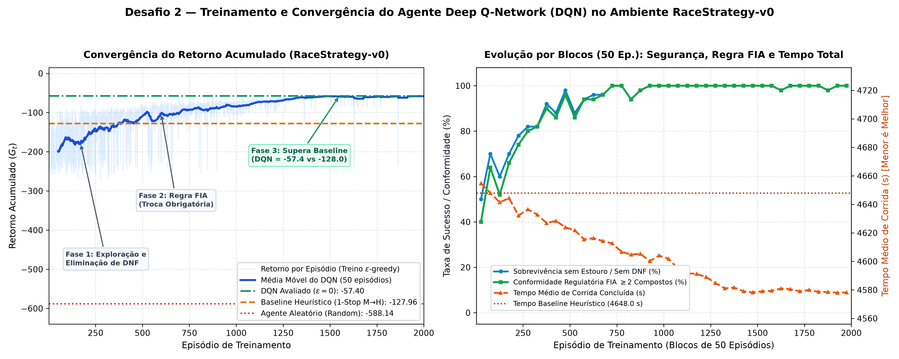
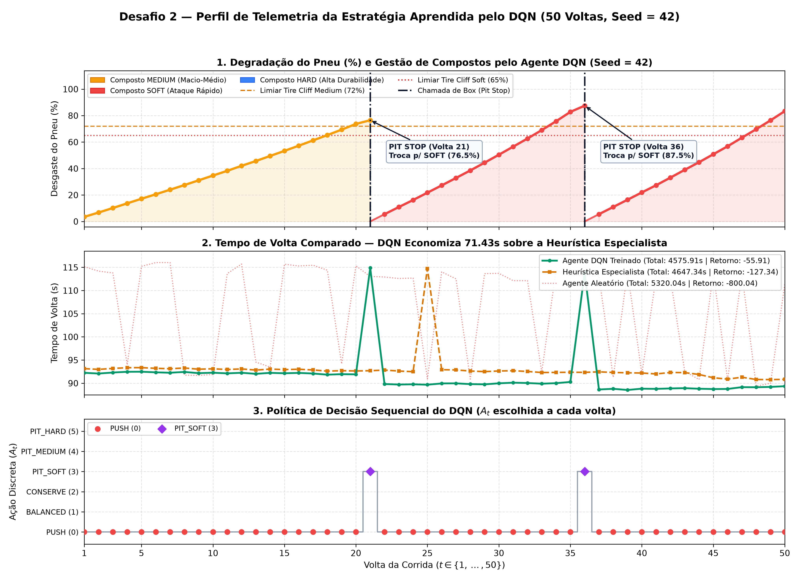

# Desafio 2 — Resultados e Análise do Agente Deep Q-Network (`RaceStrategy-v0`)

Documento de síntese técnica e guia direto para os **2 slides de resultados** do **Desafio 2**, apresentando o desempenho do agente **Deep Q-Network (Double-DQN)** frente ao **Baseline Heurístico Especialista** e ao **Agente Aleatório** no ambiente `RaceStrategy-v0`.

---

## 1. Arquitetura e Hiperparâmetros do Agente DQN (`src/agents/dqn_agent.py`)

O agente foi implementado em PyTorch seguindo arquitetura **Double-DQN** com normalização de entrada acoplada ao grafo, *Experience Replay* vetorizado e atualização suave (*Polyak Averaging*) da rede-alvo:

- **Rede Neural (`QNetwork`):** Perceptron Multicamadas (MLP) `Linear(7, 128) -> ReLU -> Linear(128, 128) -> ReLU -> Linear(128, 6)`.
- **Função de Perda e Estabilidade:** `nn.SmoothL1Loss()` (*Huber Loss*) combinada com *gradient clipping* (`max_norm = 1.0`) para amortecer gradientes severos oriundos das penalidades terminais ($-100$ por DSQ da FIA e $-50$ por estouro de pneu / DNF).
- **Hiperparâmetros (`DQNConfig`):**
  - Fator de desconto temporal: $\gamma = 0.99$ (horizonte longo de 50 voltas)
  - Taxa de aprendizado: $\mathrm{lr} = 10^{-3}$ (Otimizador Adam)
  - Tamanho do mini-batch: $64$ | Capacidade do `ReplayBuffer`: $50.000$ transições
  - Atualização da *Target Network*: *Soft Update* Polyak com $\tau = 0.005$
  - Exploração $\epsilon$-greedy: decaimento linear de $\epsilon_{\mathrm{start}} = 1.0$ até $\epsilon_{\mathrm{end}} = 0.02$ ao longo de $1.400$ episódios (total de $2.000$ episódios de treinamento).

---

## 2. Tabela Comparativa de Desempenho (Avaliação Determinística $\epsilon = 0.0$)

### 2.1. Média e Desvio Padrão em 20 Corridas de Avaliação (`seeds = 42..61`)

| Política Avaliada | Retorno Médio ($G_t$) | Tempo Total de Corrida ($\mathrm{s}$) | Nº de Pit Stops | Conformidade FIA ($\ge 2$ comp.) | Taxa de Abandono (DNF) |
|:---|:---:|:---:|:---:|:---:|:---:|
| **Agente Aleatório (Random)** | $-588.14 \pm 96.78$ | $5108.14 \pm 96.78\;\mathrm{s}$ | $23.80$ | $100.0\%$ | $0.0\%$ |
| **Heurística Especialista (Baseline 1-Stop M$\to$H)** | $-127.96 \pm 0.99$ | $4647.96 \pm 0.99\;\mathrm{s}$ | $1.00$ | $100.0\%$ | $0.0\%$ |
| **Agente DQN Treinado (2-Stop M$\to$S$\to$S)** | **$-57.40 \pm 0.87$** | **$4577.40 \pm 0.87\;\mathrm{s}$** | **$2.00$** | **$100.0\%$** | **$0.0\%$** |

### 2.2. Resultado na Corrida de Referência (`seed = 42`)

| Política Avaliada (`seed = 42`) | Retorno Acumulado ($G_t$) | Tempo Total de Prova ($\mathrm{s}$) |Diferença p/ Heurística | Estratégia Executada |
|:---|:---:|:---:|:---:|:---|
| **Agente Aleatório (Random)** | $-800.04$ | $5320.04\;\mathrm{s}$ | $+672.70\;\mathrm{s}$ | Paradas erráticas nos boxes a cada $\sim 2$ voltas |
| **Heurística Especialista (Baseline)** | $-127.34$ | $4647.34\;\mathrm{s}$ | Referência ($0.00\;\mathrm{s}$) | **1-Stop:** `Medium` (V1–24) $\to$ Box V25 $\to$ `Hard` (V25–50) |
| **Agente DQN Treinado** | **$-55.91$** | **$4575.91\;\mathrm{s}$** | **$-71.43\;\mathrm{s}$ (Mais rápido)** | **2-Stop Ataque:** `Medium` (V1–21) $\to$ `Soft` (V22–36) $\to$ `Soft` (V37–50) |

---

## 3. Guia de Conteúdo para os 2 Slides da Apresentação

### Slide 1 — Convergência e Dinâmica de Aprendizado do DQN
**Figura associada:** `docs/figures/dqn_training_curves.png`

**Tópicos-chave para apresentação no Slide 1:**
- **Aprendizado Hierárquico em 3 Estágios (Subplot Esquerdo e Direito):**
  1. **Fase 1 — Sobrevivência Mecânica (Episódios 1 a 350):** O erro TD imediato do estouro de pneu ($-50$ de penalidade $+ 60\;\mathrm{s}$ de perda na volta) ensina rapidamente o agente a evitar que `tire_wear` atinja $100\%$, reduzindo a taxa de **DNF** de $30\%$ para próximo de $0\%$.
  2. **Fase 2 — Conformidade Regulatória FIA (Episódios 350 a 800):** Graças ao fator de desconto $\gamma = 0.99$ e à variável de estado Markoviana `unique_compounds_used`, o agente propaga o bônus terminal ($+20$ vs. $-100$ DSQ na volta 50) e estabiliza **$100\%$ de conformidade FIA** a partir do episódio 800.
  3. **Fase 3 — Otimização Fina de Ritmo e Composto (Episódios 800 a 2000):** Com a redução de $\epsilon \to 0.02$, a média móvel ultrapassa com folga o **Baseline Heurístico ($-127.96$)** já no episódio 400 e converge para **$-57.40$**, reduzindo o tempo médio de prova de $\sim 4655\;\mathrm{s}$ para **$4577.40\;\mathrm{s}$**.

---

### Slide 2 — Telemetria da Estratégia Aprendida pelo DQN (50 Voltas)
**Figura associada:** `docs/figures/dqn_race_telemetry_profile.png`

**Tópicos-chave para apresentação no Slide 2:**
- **Descoberta Autônoma de Estratégia 2-Stop Agressiva (`Medium -> Soft -> Soft`):**
  - Em vez de imitar a heurística conservadora de 1 parada com pneu Duro (`Medium -> Hard`, onde o composto `Hard` penaliza $+1.00\;\mathrm{s/volta}$), o DQN descobriu que realizar **duas paradas para instalar pneus Macios (`SOFT`, $-1.20\;\mathrm{s/volta}$)** mantendo ritmo de ataque (`PUSH`, $-0.90\;\mathrm{s/volta}$) mais do que compensa os $+22.0\;\mathrm{s}$ extras de *pit lane*.
- **Precisão Cirúrgica no *Tire Cliff* (Subplot 1):**
  - **1º Stint (`MEDIUM`, Voltas 1–21):** O agente extrai performance máxima e chama `PIT_SOFT` na **Volta 21** com **$76.5\%$ de desgaste**, logo após o limiar do *Tire Cliff* do pneu Médio ($72\%$), cumprindo a Regra FIA de 2 compostos.
  - **2º Stint (`SOFT`, Voltas 22–36):** Opera em ritmo forte até a **Volta 36** (**$87.5\%$ de desgaste**), quando realiza o segundo `PIT_SOFT` antes que a penalidade cúbica ($\gamma = 3.5$) degrade severamente o tempo de volta ou cause furo.
  - **3º Stint (`SOFT`, Voltas 37–50):** Finaliza as últimas 14 voltas com pneus macios novos e tanque leve, cravando voltas na casa de **$88.7\;\mathrm{s}$** contra $\sim 92.2\;\mathrm{s}$ da heurística (Subplot 2) e economizando **$71.43\;\mathrm{s}$** no tempo total de prova.
